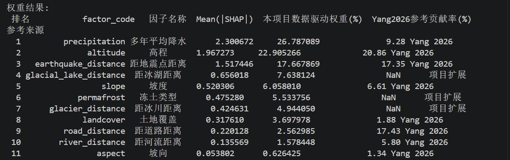

# 危险点筛查与应急救援网络分析

本仓库保存课程实习项目中使用的两份空间分析脚本。王亦彦负责主要数据获取、全部预处理、SQL Server 数据库建设、灾害分析模型设计与运行、救援路径计算；代码根据其模型设计借助 AI 辅助生成。前端 UI 由小组伙伴开发。

## 两个脚本的作用

| 文件 | 功能 | 输入 | 主要输出 |
| --- | --- | --- | --- |
| `build_geohazard_settlement_analysis_v4.py` | 11 因子加权易发性评分、候选危险点提取、规则灾种判识、D8 下泄路径及居民地影响筛查 | FileGDB、DEM、降水、冻土、土地覆盖等栅格 | 易发性 GeoTIFF、危险点/路径/影响廊道 GeoPackage、居民地关联 CSV、权重与元数据 |
| `build_hazard_rescue_network_analysis_v1_2.py` | 公路铁路联合网络、多源 Dijkstra、三类地面应急设施匹配、最近机场关联 | 已入 GDB 的危险点、公路铁路、应急设施 | 路线及设施 GeoPackage、路线属性/异常/汇总 CSV、机场关联及元数据 |

**CatBoost 训练与 SHAP 解释在这两份脚本之前完成。** 第一份脚本的 `Config.weights` 保存已获得的 11 项归一化 SHAP 权重，脚本据此评分，不调用 CatBoost 训练或重新计算 SHAP 值。实习后因硬盘故障，训练与 SHAP 计算代码暂未找回，现存原始运行截图及后续分析脚本。因此，本仓库不是完整的训练复现实验包，也不包含模型文件、训练样本、调参记录或评价指标文件。网页上展示的 1,582 点、4,566 条路线是已保存项目成果，不保证换一套数据后得到相同数量。

## 原始运行结果



截图由项目作者提供，为当时控制台运行结果。`SHAP_weights.csv` 整理了截图中的 Mean(|SHAP|)、项目权重和论文参考值；原始权重百分比与危险点脚本中的 `SHAP_ORIGINAL_PERCENT` 逐项一致。截图不包含训练样本量、数据集划分、参数、Accuracy 或 AUC，不能据此补推模型精度或完整复现训练过程。公开脚本的配置权重按原百分比归一化；论文参考值不是本项目实验指标。

## 环境与数据准备

建议使用单独的 Python 3.10+ 环境。依赖见 `requirements.txt`，未锁定到原实验版本；GeoPandas、Rasterio、Pyogrio 还依赖相应 GDAL 驱动，需要能读取 FileGDB 并写入 GeoPackage。`fiona` 仅作为备用图层枚举方式，不是 Pyogrio 正常工作时的必需依赖。

```bash
python -m pip install -r requirements.txt
```

从仓库根目录运行。默认数据组织如下，运行前请按自己的数据位置修改两个脚本开头的 `Config` 路径与图层/字段配置：

```text
data/
  NewDefault.gdb/
  rasters/
    TNR_DEM_RS.tif
    TNR_PERMAFROST_RS.tif
    TNR_SLOPE_RS.tif             # 可选，可由 DEM 派生
    TNR_ASPECT_RS.tif            # 可选，可由 DEM 派生
    TNR_RELIEF_RS.tif            # 可选，可由 DEM 派生
    BASE_POPULATION_RS.tif      # 可选
    LCC_投影后/
      TNR_LANDCOVER_RS_LCC.tif
      TNR_PRECIP_ANNUAL_RS_*_LCC.tif
outputs/
```

FileGDB 所需图层名称以各脚本的 `required_layers`、`Config` 和检查输出为准。危险点脚本使用冰川、冰湖、历史灾害、历史地震、河流、公路，以及用于影响筛查的居民地数据；网络脚本读取危险点、公路、铁路、医院、救援站、消防站和机场。下载与使用原始数据时需遵守原数据源许可；本仓库不附完整 FileGDB、原始 TIFF 或数据库备份。

## 运行顺序

先检查配置。即使仅检查配置，也需要先安装脚本顶部导入的 GIS 依赖。

```bash
python build_geohazard_settlement_analysis_v4.py --check-config
python build_hazard_rescue_network_analysis_v1_2.py --check-config
```

确认输入完整后计算危险点：

```bash
python build_geohazard_settlement_analysis_v4.py
```

输出位于 `outputs/hazard_analysis`。其中 `QTP_RES_HAZARD_ANALYSIS_V4.gpkg` 的危险点层名为 `RESULT_SUSCEPTIBILITY_PT`。**第二份脚本不会自动读取这个 GeoPackage。** 要按原项目流程衔接，需用 GIS 工具将该层导入 `data/NewDefault.gdb` 并命名为 `RES_SUSCEPTIBILITY_PT`，保留危险点编号等字段，再运行：

```bash
python build_hazard_rescue_network_analysis_v1_2.py
```

输出位于 `outputs/rescue_network`。两个脚本本身不写入 SQL Server；成果导入数据库是另外的工作步骤。重复运行会重写同名 CSV/栅格，路线脚本还会替换输出目录中的同名 GeoPackage，请使用专用输出目录保存每次实验。

## 算法口径与适用范围

- 分析采用中央经线 89.5°、原点纬度 32.5°、标准纬线 27.5°/37.5° 的 Lambert 投影，格网为 1 km。11 项因子归一化后加权求和；SHAP 重要性只提供权重，因子的评分方向和类别富集度另外构造，分数不是经校准的灾害发生概率。
- 候选点阈值是 0.55。8 km 参数换算为格网半径后，使用 **17×17 像元**窗口提取局部极大值，最多保留 5,000 个候选点；相同高值平台可能产生多个点，不能把该参数解释为严格的点对点最小距离。
- 此脚本 `score_level` 的“中”等级下界是 **50 分**；报告/网页说明中为 **55 分**。候选点先按 55 分筛选，因此其 50—55 分区间不会进入候选点，但若对完整栅格分级，仍应核对这一版本差异。公开副本保留原算法，未替换阈值。
- D8 路径按 DEM 八邻域最陡下降方向追踪，结合灾种参数构造廊道并筛选坡下居民地，属于区域潜在影响筛查，不是滑坡动力学或洪水淹没模拟。人口估算依赖输入栅格的量纲；每条居民地关系记录中的人口对应整个危险点廊道，不能逐行相加当作去重总人口。
- 网络使用无向 `MultiGraph`，将线段细分至最长约 2 km，并按 20 m 网格量化节点。代码不会自动在所有线的几何交叉处打断建节点；跨越、桥隧及铁路换乘限制未被建模。
- 危险点/设施按最近网络节点接入，允许接入距离分别为 20 km/10 km。多源 Dijkstra 最小化的是**网络内部距离**，选中设施后再加两端接入距离生成总距离；它不保证含接入段的全程总距离最小。同一网络源节点有多个设施时选择接入距离较小者。
- 机场使用平面直线最近距离，不参与公路铁路寻路。道路速度、实时管制、灾损和设施实时状态未加入；成果适用于研究展示和辅助筛查，不作为实时救援调度指令。

## 发布整理与验证范围

上传文件名去掉了微信下载产生的 `(1)` 后缀；仅将 `Config` 中的开发机绝对路径替换为相对的 `data/` 与 `outputs/` 路径。未改变权重、阈值或函数实现。`provenance.json` 记录原文件与公开副本的 SHA-256 校验值。

已完成两份脚本语法编译检查，并逐一比较 46 个危险点分析函数、26 个网络分析函数的 AST，确认公开副本的函数实现与提供的文件一致；11 项权重之和通过检查。未在此发布环节安装全部 GIS 依赖或重新运行完整原始数据分析，不能将这些检查当成分析精度验证。

## 方法参考

Yang et al. (2026), *Landslide susceptibility on the Qinghai-Tibet Plateau: Key driving factors identified through machine learning*, Journal of Geographical Sciences, 36(1), 199–218. DOI: [10.1007/s11442-026-2444-6](https://doi.org/10.1007/s11442-026-2444-6)。此文作为 CatBoost/SHAP 方法背景参考；本项目调整了因子，并增加危险点筛选、影响筛查及救援网络分析。论文实验精度不作为本项目精度。
